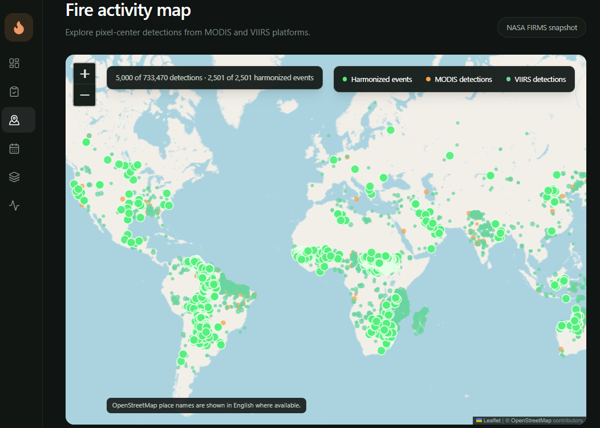
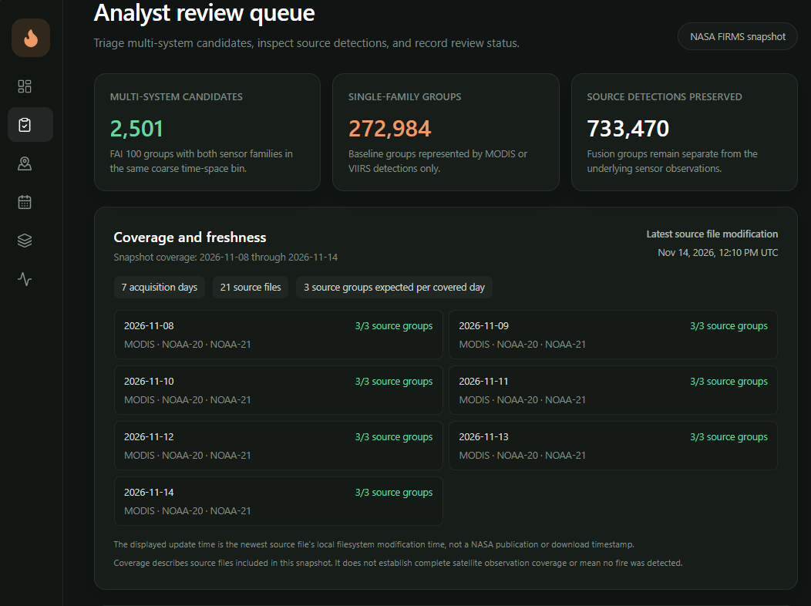
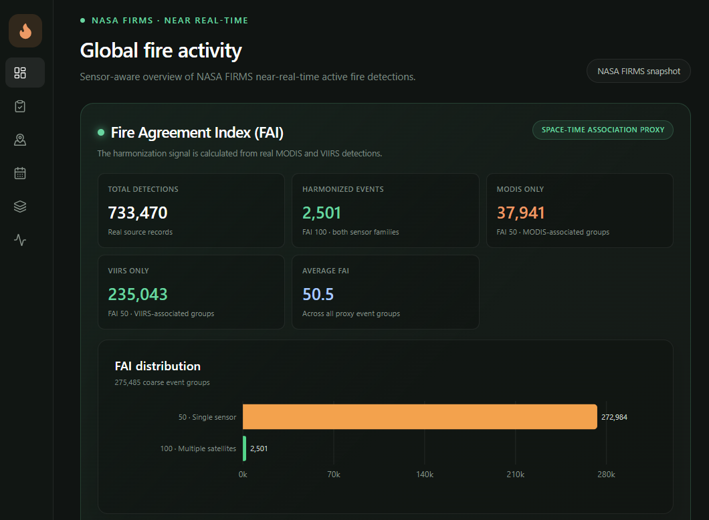

# 🔥 FireFusion

### Harmonizing MODIS and VIIRS into a Unified Fire Intelligence Workflow

**NASA Space Apps Challenge 2026**  
**Challenge:** Harmonization of MODIS and VIIRS Hot Spots

---

## Overview

> A satellite detection is a signal to investigate—not an incident confirmed.

FireFusion is an analyst-focused wildfire intelligence platform designed to help users review and interpret large volumes of NASA FIRMS active-fire detections.

The project combines MODIS and VIIRS observations into a transparent review workflow while preserving source provenance, confidence information, and sensor-specific characteristics.

Rather than treating all detections as equal, FireFusion helps analysts identify locations where multiple satellite systems report fire activity within the same space-time context.

Using 733,470 real NASA FIRMS detections, FireFusion transforms fragmented observations into structured candidate groups that support investigation, prioritization, and review.

## The Problem

Wildfire analysts often work with multiple satellite fire-detection systems.

However:

- MODIS and VIIRS use different observation characteristics
- Confidence values are not directly comparable
- Acquisition times differ
- FRP measurements have different interpretations
- Large datasets are difficult to review efficiently

As a result, analysts must manually compare information from multiple sources before deciding which locations deserve further review.

## Why FireFusion

FireFusion helps analysts answer two critical questions:

### What did each satellite system observe?

FireFusion preserves the original MODIS and VIIRS detections and their source-specific characteristics.

### Which observations are worth examining together?

FireFusion identifies candidate locations where multiple sensor families reported detections in the same coarse space-time context and surfaces those candidates for review.

## Workflow

```text
NASA FIRMS Data
(MODIS + NOAA-20 VIIRS + NOAA-21 VIIRS)

                    ↓

         Harmonization Layer

                    ↓

      Fire Agreement Index (FAI)

                    ↓

        Candidate Review Queue

                    ↓

       Evidence & Verification

                    ↓

        Analyst Decision Support
```

## Key Features

### 🌍 Interactive Fire Map



*(Bu yerga interaktiv xarita skrinshoti qo'yiladi: Global hotspot vizualizatsiyasi va sensor deteksiyalari)*

- Global hotspot visualization
- MODIS detections
- NOAA-20 VIIRS detections
- NOAA-21 VIIRS detections
- Harmonized candidate groups
- Source-level information
- Spatial exploration

### 🔄 Fire Agreement Index (FAI)

Fire Agreement Index measures cross-sensor co-occurrence.

**FAI = 100 × (Number of Sensor Families / 2)**

- FAI 50 = Single sensor family present
- FAI 100 = MODIS and VIIRS co-occurrence

FAI is designed as a review indicator and should not be interpreted as:

- A probability
- A confidence score
- A validated incident detector
- Proof that detections represent the same fire

### 👨‍💻 Analyst Review Queue



*(Bu yerga tahlilchi tekshiruv navbati skrinshoti qo'yiladi: FAI 100 guruhlari va ishonchlilik darajalari)*

A structured analyst workflow that allows users to:

- Review candidate locations
- Inspect contributing detections
- Compare confidence information
- Access source provenance
- Track review status

### ✅ Candidate Verification Panel

Each candidate includes:

- Location information
- Acquisition date/time
- Platform information
- Native confidence values
- FRP summaries
- Source-file provenance

### 📅 Burning Activity Calendar

Provides:

- Daily fire activity summaries
- Detection trends
- Platform comparisons
- Coverage awareness

### 📊 Fire Intelligence Dashboard



Includes:

- Total detections
- Harmonized candidate groups
- FAI distributions
- Confidence distributions
- FRP analysis
- Activity-priority summaries

## Dataset

FireFusion uses NASA FIRMS Near Real-Time (NRT) active-fire products.

### Data Sources

| Source | Detections |
|---|---:|
| MODIS C6.1 MCD14DL | 64,409 |
| NOAA-20 VIIRS C2 | 340,831 |
| NOAA-21 VIIRS C2 | 328,230 |
| **Total** | **733,470** |

### Coverage

November 8 – November 14, 2026  
21 source files

## Technical Architecture

### Frontend

- React
- TypeScript
- Vite
- TailwindCSS
- Leaflet
- Recharts

### Backend

- FastAPI
- Pandas
- GeoPandas

### Deployment

- Docker
- Single-Origin Frontend + API Architecture

## Project Statistics

```text
733,470 Source Detections

↓ Harmonization

275,485 Candidate Groups

↓ Cross-Sensor Review

2,501 FAI-100 Candidate Groups
```

## Scientific Transparency

FireFusion is intentionally transparent about its methodology and limitations.

### FireFusion DOES:

- ✅ Preserve source provenance
- ✅ Preserve native confidence systems
- ✅ Surface cross-sensor co-occurrence
- ✅ Support analyst review
- ✅ Provide traceable evidence

### FireFusion DOES NOT:

- ❌ Confirm wildfire incidents
- ❌ Generate fire perimeters
- ❌ Predict fire spread
- ❌ Provide evacuation guidance
- ❌ Replace expert judgment
- ❌ Serve as a life-safety decision system

## Installation

### Clone Repository

```bash
git clone [https://github.com/your-org/firefusion.git](https://github.com/your-org/firefusion.git)
cd firefusion
```

### Install Frontend

```bash
npm install
```

### Install Backend

```bash
pip install -r requirements.txt
```

### Run Development Environment

```bash
npm run dev
```

Frontend:

```text
http://localhost:5173
```

Backend:

```text
http://127.0.0.1:8000
```

API Documentation:

```text
http://127.0.0.1:8000/docs
```

## Deployment

FireFusion supports Docker-based deployment.

```bash
docker build -t firefusion .
docker run -p 8000:8000 firefusion
```

The Docker image bundles:

- Frontend
- Backend
- NASA FIRMS datasets

into a single deployment unit.

## Future Roadmap

- Incident validation studies
- Continuous FIRMS ingestion
- Shared analyst workflows
- Weather-layer integration
- Terrain and fuel-context layers
- Operational impact evaluation
- Collaborative review system

## Team

### FireFusion Team

- Anvar Sayfullaev
- Kamronbek Zaynutdinov
- Behruzbek Marufjonov

## NASA Space Apps Challenge

FireFusion was developed for:

**NASA Space Apps Challenge 2026**

Challenge:

**Harmonization of MODIS and VIIRS Hot Spots**

## License

MIT License
